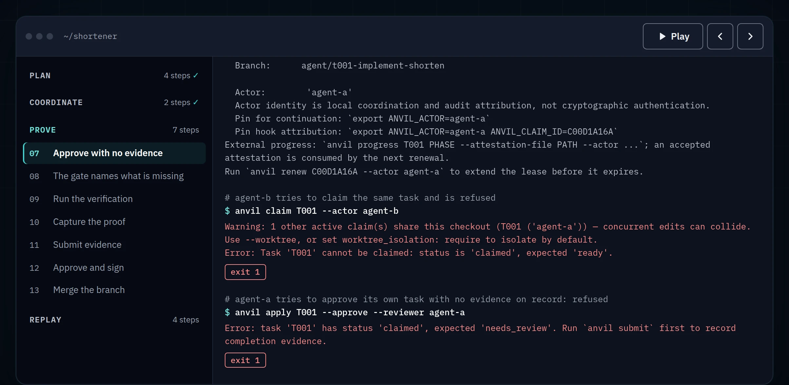

<div align="center">


<a name="anvil"></a>

# Anvil State

**The system of record for agent teams.**
Agents come and go. The record stays.

[](LICENSE)
[](.claude-plugin/plugin.json)
[](https://pypi.org/project/anvil-state/)
[](https://anvilstate.com/)
[](https://github.com/fakoli/anvil/actions/workflows/ci.yml)

</div>

---

Anvil State is an open-source, local-first ledger for AI coding agents. Requirements,
tasks, claims, and evidence live in one place on your machine, outside any
harness, so Claude Code, Codex, Cursor, and a shell loop can work the same plan
without overwriting each other. Every harness reaches that state through the
same two doors: a CLI (`anvil`) and an MCP server (`anvil-mcp`).

The product and PyPI distribution are **Anvil State** (`anvil-state`). Existing projects keep the same `anvil` command, MCP configuration, and stored data. See the [naming and compatibility guide](docs/reference/product-names.md).

It is for developers who run more than one coding agent, or one agent across
many sessions.

> **Beta — v0.6.27.** The core loop is stable and dogfooded; some command
> surfaces may change before 1.0.

## See it run

[](https://anvilstate.com/#demo)

Two agents reach for the same task and one is refused; approval is refused
until there is evidence. This is real CLI output, recorded by
[`scripts/record-site-demo.sh`](scripts/record-site-demo.sh).
**[Watch the full session replayed in the browser](https://anvilstate.com/#demo).**

## What it gives you

- **A ledger that lives outside the harness.** Every accepted change is one line
  appended to an event log, and a SQLite database is the queryable projection of
  that log. State sits outside the repository by default and is shared by every
  git worktree, so a crashed session, a compacted context, or a different
  harness opens the same tasks, claims, and evidence.
- **One queue with single-winner claims.** A claim is a database row with a
  lease, not a label. The first writer wins and everyone else is refused; a
  lease nobody renews is released and the task returns to the queue. Claims are
  live across harnesses, worktrees, and loops on one machine. Across machines
  the event log can travel in git, which is opt-in and early, and is not a live
  lock service.
- **State that replays, with guards.** The event log is the authority, and
  `anvil replay` rebuilds the database from it. Replay stops on a damaged line,
  refuses events it does not understand, and never writes into the live
  database. `anvil doctor` checks that the log still reproduces the live state,
  and CI runs a replay-equivalence check on every pull request.
- **Status downstream of proof.** A task reaches done only when submitted
  evidence is approved, and an `anvil apply` approval writes a signed, portable
  `AcceptanceProof` you can check on another machine with `anvil proof verify`.
  The evidence gate is advisory by default; `strict_evidence: true` makes it
  refuse. A proof records what a hook reported, so read it as a strong record,
  not a guarantee that the code is correct.
- **Work packets built for agents.** `anvil packet T012` renders intent,
  acceptance criteria, scope, non-goals, and verification: the contract for one
  task, sized for a small context.
- **A plan with structure.** PRDs parse into validated tasks scored across six
  dimensions (complexity, parallelizability, context load, blast radius, review
  risk, agent suitability). Several PRDs share one state, each gated separately.
  The parser and scorer are deterministic; drafting tasks with an LLM is
  optional and runs through your Claude or Codex subscription or an API
  provider.

The [landing page](https://anvilstate.com/) goes through each of these
with the limits stated next to the strengths.

## Install

```bash
uv tool install anvil-state      # installs the `anvil` CLI + `anvil-mcp` server
anvil install <harness>          # wire anvil into Codex, Cursor, VS Code, …
```

Python 3.11+ and [uv](https://docs.astral.sh/uv/) are the only requirements.
`anvil install` previews every change, backs up each file it touches, and can
roll back. Upgrading or uninstalling later? See
[Upgrading and uninstalling](https://anvilstate.com/how-to/getting-started/#upgrading-and-uninstalling).

<details>
<summary>Other ways to install (Claude Code plugin · one-line script · from source)</summary>

**As a Claude Code plugin** — registers the hooks, MCP server, and agents:

```bash
/plugin marketplace add fakoli/anvil
/plugin install anvil@anvil
```

**One-line harness setup** (installs `anvil-state`, then runs `anvil install`):

```bash
curl -fsSL https://raw.githubusercontent.com/fakoli/anvil/main/scripts/install.sh | sh -s -- <harness>
```

**From source:**

```bash
git clone https://github.com/fakoli/anvil.git && cd anvil/bin
uv sync && uv run anvil --help
```

For MCP clients without an in-place writer, `anvil mcp-config <client>` prints a
paste-ready config block.

</details>

## Quick start

```bash
anvil init --with-sample     # seed a runnable sample project
anvil next                   # → the next ready task, immediately
anvil claim T001             # lease it; a git branch is created for the work
anvil packet T001            # the exact intent, acceptance criteria, and scope
anvil submit T001 --commands "pytest" --files-changed src/foo.py
anvil apply T001 --approve   # approve the evidence → done, with a signed proof
```

That is the whole loop. The
**[getting-started guide](https://anvilstate.com/how-to/getting-started/)**
walks through it on your own PRD.

On the sample, `submit` reports `Evidence gate: INCOMPLETE`: the task asks for
a specific test command, and no proof of it was recorded. `apply --approve`
still goes through, because the gate is advisory by default. Add `--strict` to
make approval refuse until the proof is on record.

## Pick up where you are

Each guide is a complete path.

| If you want to… | Start here |
|---|---|
| Wire Anvil State into the harness you use | [Using Anvil State on any harness](https://anvilstate.com/how-to/using-anvil-on-any-harness/) |
| Ship one task end to end | [Claiming and shipping a task](https://anvilstate.com/how-to/claiming-and-shipping-a-task/) |
| Run a loop unattended | [Driving the Anvil State loop](https://anvilstate.com/how-to/drive-the-anvil-loop/) |
| Carry work across sessions | [Long-running delivery](https://anvilstate.com/how-to/long-running-delivery/) |
| Coordinate a milestone across parallel work | [Coordinating a milestone bundle](https://anvilstate.com/how-to/coordinating-a-bundle/) · [Concurrent execution journeys](https://anvilstate.com/how-to/concurrent-execution-journeys/) |
| Use a subscription or local model for the reasoning | [Execute in your harness](https://anvilstate.com/how-to/execute-in-your-harness/) |
| Watch the board | [Web interface](https://anvilstate.com/how-to/web-interface/) |
| Mirror status to GitHub Issues | [Syncing with GitHub](https://anvilstate.com/how-to/syncing-with-github/) |

## Works where your agents work

- **Native integration:** Claude Code, Codex, OpenClaw, Pi.
- **MCP in one command** (`anvil install <name> --write`): Cursor, VS Code
  (Copilot), Windsurf, Zed, Amp, OpenCode, Roo.
- **MCP by pasted config:** Cline, Continue, Goose, Gemini CLI, OpenHands.

## Recently shipped

- **A board for people.** `anvil web` shows repositories, campaigns, and tasks
  on a local Kanban board. It is read-only by default; `--allow-writes` enables
  moves and evidence-bound approvals.
- **Run and continue.** `anvil run` dispatches one task to a configured harness,
  runs the frozen checks, and stops at review (Linux only).
- **Bundles and bounded batches.** One coordinator claims a set of tasks
  atomically, delegates in bounded batches, and ships a single reviewed
  delivery.
- **Long-running delivery.** Attempt views, evidence preflight, frozen
  verification profiles, and attested external progress let work resume across
  sessions.
- **Revision-safe PRDs.** Review, approval, planning, and new claims bind the
  exact PRD revision, and `anvil prd assess` gives advisory readiness feedback.
- **Recovery.** `anvil repair projection` rebuilds a diverged projection from
  the event log with a backup, and `anvil migrate state` previews and backs up
  a schema upgrade.

The [CHANGELOG](CHANGELOG.md) has the release-by-release history.

<a name="anvil-vs-an-issue-tracker"></a>

## Anvil State vs. an issue tracker

| | Anvil State | GitHub Issues / markdown-file conventions |
|---|---|---|
| **State shape** | Pydantic models in SQLite, validated at every transition | Free-form markdown in an issue body or `.md` file |
| **Coordination** | `Claim` row with lease + heartbeat; stale leases released at coordination entry points | Assignment-by-label — no enforcement |
| **Agent hand-off** | Rendered work packet: intent, criteria, non-goals | Agent summarizes the whole thread |
| **Completion** | Evidence submitted and approved; signed, portable receipt | Trust the "done" checkbox |
| **Context cost** | Lean default MCP tool surface; planning tools load on request ([context budget](docs/context-budget.md)) | Whole threads enter context on demand |

## Measured, with caveats

- **Coordination benchmark.** Against a shared-markdown control, file collisions
  fell from 4.0 to 0.0 and duplicate completions from 9.0 to 0.0
  ([results](benchmarks/RESULTS.md)). That is one trial with simulated actors:
  a mechanism check, not a field result.
- **Ledger writes.** p95 is 12–14 ms inside the engine with 8 concurrent
  writers. At 64 writers it is 150 ms, which misses the 15 ms target
  ([validation note](docs/design/ledger-latency-validation.md)). Anvil State is
  measured at eight concurrent writers, not at swarm scale.
- **From the maintainer's own sessions.** One 23.7-hour autonomous session
  produced 32 tasks, 21 PRs, and a release. Two concurrent agent loops finished
  an 18/18-task PRD in 16.7 hours, with the lease model deconflicting both
  sessions. Review gates caught a fail-open deny gate, log-injection bugs, and
  a semantically broken "clean" merge before they shipped. The session logs
  behind these figures are not published, so treat them as anecdote.

<a name="what-anvil-is-not"></a>

## What Anvil State is not

- **Not a coding agent.** It is the layer around your agents: packets in,
  evidence out.
- **Not an orchestrator.** It does not schedule agents or pick the model that
  does the work. Dispatching a single task with `anvil run` is opt-in.
- **Not a service.** There is no hosted backend, no account, and no telemetry.
  State stays on your machine unless you turn on sync, backup, or a hosted
  model.
- **Not an issue tracker.** GitHub Issues is a sync target, not the source of
  truth.

## Web interface

Use `anvil web enroll /path/to/repository`, then `anvil web` from any directory.
The interface selects a local machine, repository, and campaign while retaining
canonical task state and reader provenance. It is read-only by default;
`anvil web --allow-writes --actor <name>` enables moves and approvals. A scoped
`anvil-web` entrypoint is also available. See
[enrollment, access and compatibility](docs/how-to/web-interface.md).

## Documentation

Full documentation: **[anvilstate.com](https://anvilstate.com/)**

- [Getting started](https://anvilstate.com/how-to/getting-started/) — first project, end to end
- [Using Anvil State on any harness](https://anvilstate.com/how-to/using-anvil-on-any-harness/) — Cursor, VS Code, Zed, Codex, …
- [Architecture](https://anvilstate.com/architecture/) · [CLI reference](https://anvilstate.com/cli-reference/) · [MCP reference](https://anvilstate.com/mcp/)
- [FAQ](https://anvilstate.com/faq/) — installing, storage, backups, and common gotchas
- [Roadmap](https://anvilstate.com/roadmap/) · [CHANGELOG](CHANGELOG.md)

## Contributing

Anvil State is MIT licensed and developed in the open; its roadmap, backlog, and
design decisions live in the docs. Good places to start are a
[sync provider](docs/sync-providers.md) (GitHub Issues ships today), packaging a
harness that is missing, and the docs themselves. The
[contributing guide](docs/contributing.md) covers the test workflow and how to
work on the docs site.

Run the same locked lint gate as CI from the source checkout:

```bash
cd bin
uv sync --locked --extra custom
uv run --locked ruff check ..
cd ..
uv run --project bin pytest
```

One pull request per change. CI and an automated review have to pass before it
merges.

## Status

Beta (v0.6.27). The full PRD → plan → claim → execute → verify → finish loop
works today, alongside GitHub Issues sync and optional LLM planning.
Near-term focus is provider expansion, usability, and remaining pre-1.0
contract hardening; Linear/Monday providers and webhook sync are on the
[roadmap](https://anvilstate.com/roadmap/).

## License

MIT — see [LICENSE](LICENSE). Built by Fakoli
([@fakoli](https://github.com/fakoli)).
