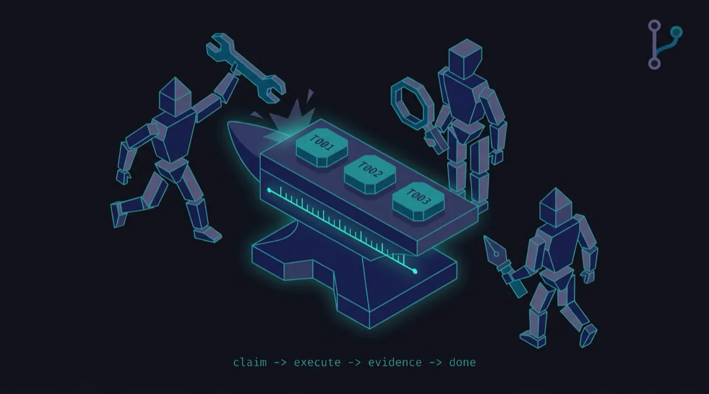

<!--
  Landing page. The shell is overrides/home.html; styles are
  docs/stylesheets/home.css; the terminal replay is
  docs/javascripts/terminal-demo.js playing docs/demo/session.json.

  Editing rules for this page:
  - Every claim here is checked against the code. If you change a claim,
    check it the same way, and keep the stated limits next to the strengths.
  - No version numbers and no counts of tools, commands or tests: they go
    stale. Link to the reference page that owns the number instead.
  - Links are plain relative URLs (how-to/getting-started/), because raw HTML
    is not rewritten by MkDocs.
  - Command output in a <figure class="sample" data-recorded> is copied from
    docs/demo/*.json; tests/test_site_landing.py fails if it stops matching.
    Re-record with scripts/record-site-demo.sh rather than editing it.
-->

<section class="hero anvil-ink" aria-labelledby="hero-title">

The system of record for agent teams

<h1 class="hero__title" id="hero-title">Agents come and go. The record stays.</h1>

Anvil is an open-source, local-first ledger for AI coding agents. Requirements, tasks, claims and evidence live in one place on your machine, outside any harness, so Claude Code, Codex, Cursor and a shell loop can work the same plan without overwriting each other.

<a class="btn btn--primary" href="how-to/getting-started/">Get started</a>
<a class="btn btn--ghost" href="https://github.com/fakoli/anvil">View on GitHub</a>

<code class="install__cmd">uv tool install anvil-state</code>
<button class="install__copy" type="button" data-copy="uv tool install anvil-state" aria-label="Copy install command">

<svg class="install__icon-copy" viewBox="0 0 16 16" fill="none" stroke="currentColor" stroke-width="1.75" stroke-linecap="round" stroke-linejoin="round"><rect x="5.5" y="5.5" width="8" height="8" rx="1.5"/><path d="M10.5 5.5v-2a1 1 0 0 0-1-1h-6a1 1 0 0 0-1 1v6a1 1 0 0 0 1 1h2"/></svg>
<svg class="install__icon-done" viewBox="0 0 16 16" fill="none" stroke="currentColor" stroke-width="1.75" stroke-linecap="round" stroke-linejoin="round"><path d="m3 8.5 3.2 3.2L13 4.8"/></svg>

Copy
</button>

On Claude Code? <a href="how-to/getting-started/#step-1-install-the-plugin">Install the Claude Code plugin</a> instead.

<ul class="hero__facts">
<li>MIT licensed</li>
<li>Python 3.11+</li>
<li>No account, no hosted backend</li>
</ul>

<h2 class="stage__title">Watch one task go from claimed to proven</h2>

A real session, replayed. Two agents reach for the same task, approval is refused until there is evidence, and the finished state is rebuilt from the event log.

<i></i><i></i><i></i>
~/shortener

 

<button class="term__btn" type="button" data-term-toggle>
<svg class="term__icon-play" viewBox="0 0 16 16" fill="currentColor" aria-hidden="true"><path d="M5 3.2v9.6a.6.6 0 0 0 .92.5l7.3-4.8a.6.6 0 0 0 0-1L5.92 2.7A.6.6 0 0 0 5 3.2Z"/></svg>
<svg class="term__icon-pause" viewBox="0 0 16 16" fill="currentColor" aria-hidden="true"><rect x="3.5" y="2.5" width="3.2" height="11" rx="0.8"/><rect x="9.3" y="2.5" width="3.2" height="11" rx="0.8"/></svg>
Play
</button>
<button class="term__btn" type="button" data-term-prev aria-label="Previous step">
<svg viewBox="0 0 16 16" fill="none" stroke="currentColor" stroke-width="1.75" stroke-linecap="round" stroke-linejoin="round" aria-hidden="true"><path d="M10 3.5 5.5 8l4.5 4.5"/></svg>
</button>
<button class="term__btn" type="button" data-term-next aria-label="Next step">
<svg viewBox="0 0 16 16" fill="none" stroke="currentColor" stroke-width="1.75" stroke-linecap="round" stroke-linejoin="round" aria-hidden="true"><path d="M6 3.5 10.5 8 6 12.5"/></svg>
</button>

<ol class="term__steps" data-term-steps aria-label="Steps in the recorded session"></ol>

<noscript>
The replay needs JavaScript. The <a href="how-to/getting-started/">getting-started guide</a> walks through the same loop.
</noscript>

Recorded from the real CLI by <a href="https://github.com/fakoli/anvil/blob/main/scripts/record-site-demo.sh"><code>scripts/record-site-demo.sh</code></a>. Output is unedited apart from shortened paths; the demo keeps its state inside the project folder so you can see the files.

</section>

<section class="band" id="why" aria-labelledby="why-title">

Why a system of record

<h2 class="title" id="why-title">Chat is not a database</h2>

Anvil is for developers who run more than one coding agent, or one agent across many sessions. That work fails in three predictable ways, and a better model does not fix any of them.

<ul class="grid grid--3">
<li class="card">
<h3 class="card__title">Two agents, one file</h3>

“Assigned” is a label, not a lock. Parallel sessions pick up the same task, or different tasks that touch the same file, and the last write wins.

</li>
<li class="card">
<h3 class="card__title">“Done,” with nothing behind it</h3>

A checkbox flips. Nobody can say which command ran, what it returned, or who approved the result.

</li>
<li class="card">
<h3 class="card__title">The plan dies with the session</h3>

Context compacts, the session ends, or you switch tools. The plan lived in the conversation, so it goes too.

</li>
</ul>

Anvil moves the plan, the locks and the evidence out of the conversation and into a ledger every agent shares.

<ul class="grid grid--4">
<li class="card card--link">

01 · Ledger

<h3 class="card__title"><a href="#ledger">One record, outside the harness</a></h3>
</li>
<li class="card card--link">

02 · Coordination

<h3 class="card__title"><a href="#coordination">One queue, single-winner claims</a></h3>
</li>
<li class="card card--link">

03 · Replay

<h3 class="card__title"><a href="#replay">State rebuilt from the log, safely</a></h3>
</li>
<li class="card card--link">

04 · Proof

<h3 class="card__title"><a href="#proof">Done comes with a receipt</a></h3>
</li>
</ul>

</section>

<section class="band band--alt" id="loop" aria-labelledby="loop-title">

How it works

<h2 class="title" id="loop-title">Plan, claim, execute, prove</h2>

The whole loop is four moves. Anvil keeps the record of each one; your harness does the work.

<ol class="loop">
<li>
<h3>Plan</h3>

Write a PRD, a product requirements document. Anvil parses it into tasks with dependencies, acceptance criteria and verification commands, and you approve the plan.

</li>
<li>
<h3>Claim</h3>

An agent asks for the next ready task and takes it under a lease. Until the lease is released or expires, nobody else can.

</li>
<li>
<h3>Execute</h3>

The agent works from a packet: intent, criteria, scope and non-goals. Where the harness has hooks, the checks it runs are captured as it goes.

</li>
<li>
<h3>Prove</h3>

Evidence goes to review. Approval marks the task done and writes a signed receipt of what was accepted.

</li>
</ol>

<a href="glossary/">Look up a term in the glossary</a>

<figure class="art split__aside">

</figure>

</section>

<section class="band" id="ledger" aria-labelledby="ledger-title">

01 · Ledger

<h2 class="title" id="ledger-title">A ledger that lives outside the harness</h2>

Every accepted change is one line appended to an event log, and a SQLite database is the queryable projection of that log. Together they are the ledger. It sits in a state directory on your machine, outside the repository by default and shared by every git worktree, and every harness reaches it through the same two doors.

<ul class="points points--ruled">
<li>
<h3>It survives the session</h3>

A crashed session, a compacted context or a different harness opens the same tasks, claims and evidence. Work resumes from the record, not from memory.

</li>
<li>
<h3>There is one write path</h3>

Take the lock, validate, append the event, update the projection. A rejected request never enters the log.

</li>
<li>
<h3>There is nothing to host</h3>

No account and nothing to deploy. State is plain files you can inspect, back up and replay.

</li>
</ul>

<a href="architecture/">Read the architecture</a> <a href="how-to/state-location/">See where state lives</a>

<figure class="flow split__aside" aria-label="How a harness reaches the ledger">
<ol class="flow__rows">
<li class="flow__row">

Any harness

<ul class="names">
<li>Claude Code</li><li>Codex</li><li>Cursor</li><li>VS Code</li><li>Zed</li><li>OpenClaw</li><li>Pi</li><li>a shell loop</li>
</ul>
</li>
<li class="flow__row">

Two doors

<ul class="flow__doors">
<li class="flow__door"><code>anvil</code>CLI for shells, loops and people</li>
<li class="flow__door"><code>anvil-mcp</code>MCP server over stdio, for any MCP client</li>
</ul>
</li>
<li class="flow__row">

One write path

<ol class="flow__path">
<li>lock</li><li>validate</li><li>append</li><li>project</li>
</ol>
</li>
<li class="flow__row">

One record

<ul class="flow__store">
<li class="flow__file"><strong>events.jsonl</strong>The authority. One line per accepted change.</li>
<li class="flow__file"><strong>state.db</strong>The projection. Rebuildable from the log.</li>
</ul>
</li>
</ol>
</figure>

</section>

<section class="band band--alt" id="coordination" aria-labelledby="coordination-title">

02 · Coordination

<h2 class="title" id="coordination-title">One queue for every harness</h2>

Agents pull work instead of being handed it. A harness asks for the next task it is eligible for, claims it under a lease, does the work and submits evidence. Anvil decides who holds what. The harness decides how the work gets done.

<ul class="points points--ruled">
<li>
<h3>Claims have one winner</h3>

A claim is a database row with a lease, not a label. The first writer wins and everyone else is refused.

</li>
<li>
<h3>Leases expire</h3>

Renewal needs observed progress. A lease nobody renews is released the next time anyone asks for or claims work, and the task returns to the queue.

</li>
<li>
<h3>The queue knows about conflicts</h3>

<code>anvil next</code> skips tasks with unmet dependencies, active claims or declared files that overlap work in flight.

</li>
<li>
<h3>A harness sets its own ceiling</h3>

<code>anvil next --max-blast</code> and <code>--max-review-risk</code>, both experimental, let a smaller or local model pull only the work it should take. The queue filters by risk; it does not route by model.

</li>
<li>
<h3>Milestones ship as a bundle</h3>

One coordinator claims a set of tasks atomically, delegates in bounded batches and ships a single reviewed delivery.

</li>
</ul>

<figure class="sample" data-recorded>
<figcaption class="sample__cap">Two agents, one task</figcaption>
<pre>$ anvil claim T001 --actor agent-a
Claimed task 'T001' as 'agent-a'.

$ anvil claim T001 --actor agent-b
Error: Task 'T001' cannot be claimed: status is 'claimed', expected 'ready'.</pre>
</figure>

<strong>Measured:</strong> in our coordination benchmark, file collisions fell from 4.0 to 0.0 and duplicate completions from 9.0 to 0.0 against a shared-markdown control. That is one trial with simulated actors, so read it as a mechanism check, not a field result. <a href="https://github.com/fakoli/anvil/blob/main/benchmarks/RESULTS.md">Read the benchmark results</a>.

One machine or several, stated plainly.

<ul class="grid grid--3">
<li class="card">
Shipped
<h3 class="card__title">On one machine, claims are live</h3>

Any mix of harnesses, worktrees and unattended loops shares one queue, so when one subscription hits its rate limit another keeps pulling. Claims are enforced in real time by database transactions and a file lock.

</li>
<li class="card">
Opt-in · early
<h3 class="card__title">Across machines, the event log rides in git</h3>

Keep state in the repository, store the event log in git, and it travels with your commits to a second laptop or a cloud session: hash-derived event ids, union merges and a deterministic replay order. Competing claims resolve at replay, earliest first, and the loser is not notified yet. This is not a live lock service. Convert on macOS or Linux, before the PRD is first reviewed.

</li>
<li class="card">
Shipped
<h3 class="card__title">People follow along in GitHub</h3>

GitHub Issues sync mirrors task status where stakeholders already look. <code>anvil backup</code> pushes the event log to an S3 bucket you own, and <code>anvil restore</code> replays it elsewhere. Neither enforces a lease.

</li>
</ul>

<a href="how-to/coordinating-a-bundle/">Coordinate a milestone bundle</a> <a href="migrations/#git-backed-events">Move the event log into git</a> <a href="how-to/syncing-with-github/">Set up GitHub sync</a>

</section>

<section class="band" id="replay" aria-labelledby="replay-title">

03 · Replay

<h2 class="title" id="replay-title">State replays, and replay is guarded</h2>

The event log is the authority, so the database can be rebuilt from it. <code>anvil replay</code> applies every event through the same handlers the live path uses, and on every pull request CI replays a recorded history and checks the rebuilt state against the expected one.

<ul class="grid grid--4 guards">
<li class="card">

<h3 class="card__title">Log first, then project</h3>

The event is appended before the database changes. If a crash lands between the two, the next open applies the missing tail.

</li>
<li class="card">

<h3 class="card__title">One writer at a time</h3>

A cross-process lock serializes appends, and event ids are assigned inside it. Concurrent writers cannot collide or drop events.

</li>
<li class="card">

<h3 class="card__title">Replay stops on damage</h3>

A damaged line stops the replay with an error. Nothing is skipped silently; only a torn final line is tolerated.

</li>
<li class="card">

<h3 class="card__title">Unknown events are refused</h3>

Live writes reject an event the engine does not understand, and replay aborts on one.

</li>
<li class="card">

<h3 class="card__title">Satisfied requests add nothing</h3>

A request the state already satisfies, such as releasing a released claim, adds no event. Not every command is idempotent: scoring a task twice records two events.

</li>
<li class="card">

<h3 class="card__title">Live state is off limits</h3>

Replay builds into a scratch database and refuses to target the live one.

</li>
<li class="card">

<h3 class="card__title">Drift is found and repaired</h3>

<code>anvil doctor</code> replays to scratch and compares. <code>anvil repair projection</code> backs up, rebuilds, verifies, then publishes.

</li>
<li class="card">

<h3 class="card__title">Versions are fenced</h3>

An older engine refuses before it writes. A newer one upgrades the schema on first open and refuses while a claim is active; <code>anvil migrate state</code> makes the upgrade a previewed, backed-up step.

</li>
</ul>
<dl class="stats">

<dt class="stat__value">12–14 ms</dt>
<dd class="stat__label">p95 write inside the engine, 8 concurrent writers</dd>
<dd class="stat__note">Engine time, not CLI response time. Inside our 15 ms target, with and without a board reading alongside.</dd>

<dt class="stat__value">8,000 of 8,000</dt>
<dd class="stat__label">transitions recorded</dd>
<dd class="stat__note">None missing and none duplicated across the contention runs.</dd>

<dt class="stat__value">150 ms</dt>
<dd class="stat__label">p95 at 64 writers</dd>
<dd class="stat__note">That misses the target. Anvil is measured at eight concurrent writers, not at swarm scale.</dd>

</dl>

<strong>What this does not claim.</strong> The log is append-only and auditable, not tamper-proof: signatures cover acceptance proofs, not the log itself. Default durability favors speed and can lose the last few events in a hard power cut; set <code>durability: strict</code> to sync every event. The figures above are synthetic and come from the <a href="design/ledger-latency-validation/">ledger latency validation note</a>.

<a href="migrations/">How migrations stay safe</a> <a href="design/">Read the design rationale</a>

</section>

<section class="band proof anvil-ink" id="proof" aria-labelledby="proof-title">

04 · Proof

<h2 class="title" id="proof-title">Status is downstream of proof</h2>

An agent saying “done” changes nothing. A task reaches done only when submitted evidence is approved, and an <code>anvil apply</code> approval leaves a signed receipt of what was accepted.

<figure class="art">

</figure>

<ul class="grid grid--3 proof__grid">
<li class="card">

Record

<h3 class="card__title">Command proofs</h3>

The exact command, its exit code, a SHA-256 of its output and the claim it ran under. Free text cannot stand in for one.

</li>
<li class="card">

Gate

<h3 class="card__title">No evidence, no approval</h3>

Approval always needs submitted evidence, and the approval is itself recorded. In strict mode it is also refused until every required check has a matching, passing command proof.

</li>
<li class="card">

Receipt

<h3 class="card__title">Signed acceptance proofs</h3>

An <code>anvil apply</code> approval writes an Ed25519-signed receipt that binds the project, task, claim, submitting actor, command results and event range. <code>anvil proof verify</code> checks it on another machine against a trust list you control.

</li>
</ul>

<figure class="sample" data-recorded>
<figcaption class="sample__cap">Strict mode: approval without the proof</figcaption>
<pre>$ anvil apply T001 --approve --strict --reviewer human
Error: strict evidence gate REFUSED approval of task 'T001': required evidence is missing. Task remains in needs_review.
  - `pytest -q` exits 0
Submit the missing evidence and re-run, or use --no-strict to override for this invocation.</pre>
</figure>
<figure class="sample" data-recorded>
<figcaption class="sample__cap">With the proof on record</figcaption>
<pre>$ anvil apply T001 --approve --reviewer human
Task 'T001' approved by 'human' → done.
  Signed proof: ~/shortener/.anvil/proofs/T001-E000017.json</pre>
</figure>

<h3>What the record establishes</h3>
<ul class="terms--does">
<li>A command was recorded with this exit code and this output hash.</li>
<li>It is bound to this claim, this actor and this task and PRD revision.</li>
<li>A key on your trust list signed the acceptance, and the receipt has not been altered since.</li>
<li>The checks can be frozen at planning with a <a href="how-to/verification-profiles/">verification profile</a>, so the files that define them cannot change unnoticed.</li>
</ul>

<h3>What it does not</h3>
<ul class="terms--doesnt">
<li>It does not prove the code is correct, or that the command really ran. A hook reports the result and Anvil does not re-run it, so an agent that can write the evidence buffer could forge one.</li>
<li>The gate is advisory by default: it reports what is missing and lets a person approve. Set <code>strict_evidence: true</code> to refuse by default.</li>
<li>Anvil runs checks itself only when you ask it to: with <code>anvil run</code> on Linux, or from a workflow file.</li>
<li>Actor names are attribution, not authentication, and an actor can approve its own submission. The record shows who did.</li>
</ul>

<strong>Where this is going.</strong> Re-running recorded commands independently and a gate that is strict by default are next on the <a href="roadmap/">roadmap</a>. Until they land, read a proof as a strong record, not a guarantee.

<a href="how-to/claiming-and-shipping-a-task/">Claim and ship a task</a> <a href="evidence-buffer/">How evidence is captured</a> <a href="how-to/attempt-views/">How attempt views work</a>

</section>

<section class="band" id="more" aria-labelledby="more-title">

Also in the box

<h2 class="title" id="more-title">A plan agents can execute</h2>

<ul class="grid grid--4">
<li class="card">
<h3 class="card__title">Work packets, not threads</h3>

<code>anvil packet T012</code> renders intent, acceptance criteria, scope, non-goals and verification: the contract for one task, sized for a small context.

</li>
<li class="card">
<h3 class="card__title">Six-dimension scoring</h3>

Complexity, parallelizability, context load, blast radius, review risk and agent suitability drive routing, not a single story-point number.

</li>
<li class="card">
<h3 class="card__title">Several PRDs, one state</h3>

Each PRD is gated and approved separately, like a Terraform workspace. Conflict detection spans all of them.

</li>
<li class="card">
<h3 class="card__title">A board for people</h3>

A local Kanban view over the same state. It is read-only unless you start it with write access.

</li>
</ul>

</section>

<section class="band band--alt" id="journeys" aria-labelledby="journeys-title">

Journeys

<h2 class="title" id="journeys-title">Pick up where you are</h2>

Each guide is a complete path, from a five-minute first project to coordinating a milestone across parallel workers.

<h3 class="lane__title">Start</h3>
<ul class="grid">
<li class="card card--link">
<h4 class="card__title"><a href="how-to/getting-started/">Run your first project</a></h4>

Init, PRD, plan, claim, evidence, done, in about five minutes.

</li>
<li class="card card--link">
<h4 class="card__title"><a href="how-to/using-anvil-on-any-harness/">Wire Anvil into your harness</a></h4>

One command for Codex, Cursor, VS Code, Zed and more; a plugin for Claude Code.

</li>
<li class="card card--link">
<h4 class="card__title"><a href="how-to/execute-in-your-harness/">Execute in your own session</a></h4>

With <code>llm_provider: harness</code>, your own session does the reasoning and Anvil makes no model calls.

</li>
<li class="card card--link">
<h4 class="card__title"><a href="how-to/authoring-a-prd/">Author a PRD</a></h4>

The input format, readiness checks and how approval binds a revision.

</li>
</ul>

<h3 class="lane__title">Ship</h3>
<ul class="grid">
<li class="card card--link">
<h4 class="card__title"><a href="how-to/claiming-and-shipping-a-task/">Claim and ship a task</a></h4>

The whole loop for one task: claim, packet, submit, apply.

</li>
<li class="card card--link">
<h4 class="card__title"><a href="how-to/drive-the-anvil-loop/">Drive the loop unattended</a></h4>

Turn a shell loop, a cron job or a Codex automation into a loop that pulls work.

</li>
<li class="card card--link">
<h4 class="card__title"><a href="how-to/long-running-delivery/">Deliver across sessions</a></h4>

Resume long-running work from an attempt view and an evidence preflight.

</li>
<li class="card card--link">
<h4 class="card__title"><a href="how-to/attesting-external-progress/">Attest progress from outside</a></h4>

Renew a lease from a writer the hooks cannot see.

</li>
</ul>

<h3 class="lane__title">Scale</h3>
<ul class="grid">
<li class="card card--link">
<h4 class="card__title"><a href="how-to/coordinating-a-bundle/">Coordinate a milestone bundle</a></h4>

Several tasks, one coordinator, one reviewed delivery.

</li>
<li class="card card--link">
<h4 class="card__title"><a href="how-to/concurrent-execution-journeys/">Run tasks concurrently</a></h4>

Authorize a bounded batch, collect proof from each member and continue from the CLI.

</li>
<li class="card card--link">
<h4 class="card__title"><a href="how-to/web-interface/">Watch the board</a></h4>

Repositories, campaigns and tasks on a local Kanban board.

</li>
<li class="card card--link">
<h4 class="card__title"><a href="how-to/harness-execution/">Dispatch a task from Anvil</a></h4>

<code>anvil run</code> hands one task to a configured harness, runs the frozen checks and stops at review. Linux only.

</li>
</ul>

</section>

<section class="band" id="harnesses" aria-labelledby="harnesses-title">

Harnesses

<h2 class="title" id="harnesses-title">Works where your agents work</h2>

Anvil is not tied to one harness. Install it once, then wire it into the ones you run. The installer previews every change, backs up each file it touches and can roll back.

<h3>Native integration</h3>

A plugin or package: skills or commands, hooks and tools

<ul class="names names--lg"><li>Claude Code</li><li>Codex</li><li>OpenClaw</li><li>Pi</li></ul>

<h3>MCP in one command</h3>

<code>anvil install &lt;name&gt; --write</code>

<ul class="names names--lg"><li>Cursor</li><li>VS Code (Copilot)</li><li>Windsurf</li><li>Zed</li><li>Amp</li><li>OpenCode</li><li>Roo</li></ul>

<h3>MCP by pasted config</h3>

<code>anvil mcp-config &lt;name&gt;</code> or a packaged snippet

<ul class="names names--lg"><li>Cline</li><li>Continue</li><li>Goose</li><li>Gemini CLI</li><li>OpenHands</li></ul>

<a href="how-to/using-anvil-on-any-harness/">Set up your harness</a> <a href="mcp/">Browse the MCP tools</a> <a href="cli-reference/">Browse the CLI</a>

</section>

<section class="band band--alt" id="not" aria-labelledby="not-title">

Orchestration is the hammer and the agents are the hand. Both keep changing. <em>The anvil is the surface the work is done on.</em>

Scope

<h2 class="title" id="not-title">What Anvil is not</h2>

<ul class="grid grid--4">
<li class="card">
<h3 class="card__title">Not a coding agent</h3>

It is the layer around your agents: packets in, evidence out.

</li>
<li class="card">
<h3 class="card__title">Not an orchestrator</h3>

It does not schedule agents or pick the model that does the work. Dispatching a single task with <code>anvil run</code> is opt-in.

</li>
<li class="card">
<h3 class="card__title">Not a service</h3>

There is no hosted backend, no account and no telemetry. State stays on your machine unless you turn on sync, backup or a hosted model.

</li>
<li class="card">
<h3 class="card__title">Not an issue tracker</h3>

GitHub Issues is a sync target, not the source of truth.

</li>
</ul>

<strong>Status: beta.</strong> The core loop is stable and is used to build Anvil itself. Some command surfaces may still change before 1.0. The <a href="roadmap/">roadmap</a> says what is shipped and what is planned.

</section>

<section class="band" id="contribute" aria-labelledby="contribute-title">

Open source

<h2 class="title" id="contribute-title">Built in the open. Come build it.</h2>

Anvil is MIT licensed, and its roadmap and design rationale live in these docs. It is a small project, which means a good pull request changes it.

<ul class="points points--ruled">
<li>
<h3>Add a sync provider</h3>

GitHub Issues ships today. Linear is open on the roadmap and unclaimed, and there is a <a href="sync-providers/">step-by-step guide to building a provider</a>.

</li>
<li>
<h3>Package a harness</h3>

If the harness you use is missing, the installer is a table you can add a row to.

</li>
<li>
<h3>Improve the docs</h3>

Every page has an edit link. Fixes to guides and examples are welcome.

</li>
</ul>

<figure class="sample">
<figcaption class="sample__cap">Run it from source</figcaption>
<pre>$ git clone https://github.com/fakoli/anvil.git
$ cd anvil
$ uv run --project bin anvil --help
$ uv run --project bin pytest</pre>
</figure>

One pull request per change. CI and an automated review have to pass before it merges.

<a href="contributing/">Read the contributing guide</a> <a href="roadmap/">See the roadmap</a> <a href="https://github.com/fakoli/anvil/blob/main/docs/backlog/anvil-backlog.md">Browse the backlog on GitHub</a> <a href="https://github.com/fakoli/anvil/issues">Open an issue on GitHub</a>

</section>

<section class="band close anvil-ink" aria-labelledby="close-title">

<h2 class="title" id="close-title">Give your agents something solid to work on</h2>

Install the CLI, then run a complete project, from PRD to signed proof, in about five minutes.

<code class="install__cmd">uv tool install anvil-state</code>
<button class="install__copy" type="button" data-copy="uv tool install anvil-state" aria-label="Copy install command">

<svg class="install__icon-copy" viewBox="0 0 16 16" fill="none" stroke="currentColor" stroke-width="1.75" stroke-linecap="round" stroke-linejoin="round"><rect x="5.5" y="5.5" width="8" height="8" rx="1.5"/><path d="M10.5 5.5v-2a1 1 0 0 0-1-1h-6a1 1 0 0 0-1 1v6a1 1 0 0 0 1 1h2"/></svg>
<svg class="install__icon-done" viewBox="0 0 16 16" fill="none" stroke="currentColor" stroke-width="1.75" stroke-linecap="round" stroke-linejoin="round"><path d="m3 8.5 3.2 3.2L13 4.8"/></svg>

Copy
</button>

<a class="btn btn--primary" href="how-to/getting-started/">Get started</a>
<a class="btn btn--ghost" href="faq/">Read the FAQ</a>

</section>
